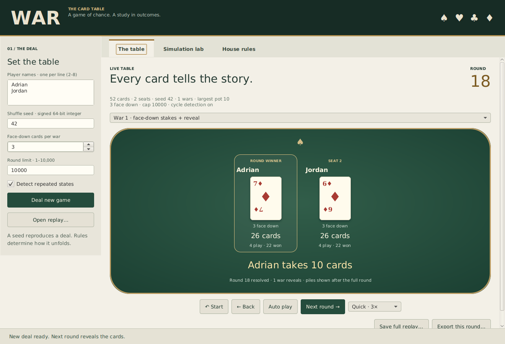
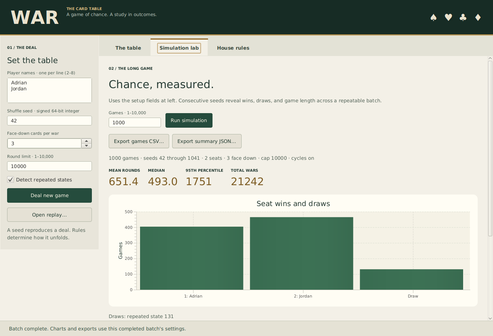

# War — Deterministic Card Game Simulation

A Java War card-game engine with multiplayer ties, reproducible deals, verifiable replay files, and batch simulation exports. It evolves the original interactive console coursework while retaining the player/play-pile/won-pile structure. The original files remain in [`legacy/`](legacy/README.md).

**Version 1.0.0 — The Card Table.** A JavaFX desktop adds seeded deals, round-by-round playback, verified replay viewing, and a simulation lab with charts and CSV/JSON exports. The console workflow remains available.



## Open the card table

```sh
mvn javafx:run
```

Requires Java 17+, Maven 3.9+, a graphical desktop, and the platform libraries required by JavaFX (on Ubuntu: `libgtk-3-0t64 libxtst6`). Maven downloads the JavaFX dependencies for the current OS. No account, API key, or service is needed. Portable and bundled-runtime application ZIPs are built for Linux, Windows, and macOS. See [release instructions](docs/release.md) for packages, OS/CPU requirements, checksums, and draft-release status.

The table uses a felt-and-brass card-game design. Deal 2–8 named seats; step through rounds, review earlier rounds, or auto-play at three speeds. Select each reveal in a tied round to see its face-up cards and face-down stake counts. Post-round pile counts, round awards, and terminal draw reasons are explicit. The separate **Simulation lab** runs consecutive-seed batches on a background worker, charts outcomes and game lengths, and exports completed reports. See the [desktop guide](docs/desktop.md) for playback, replay, and cancellation details.



## Build and run

Requires **Java 17+ and Maven 3.9+** to build. The standalone **console** JAR requires only Java; its engine/CLI code has no runtime dependencies or external services. JavaFX is used only by the desktop entry point.

```sh
mvn clean verify
java -jar target/war-simulation.jar help
java -jar target/war-simulation.jar play --seed 42 --names Adrian,Jordan --verbose
```

The names option is comma-separated. Quote the whole argument if it contains spaces, for example `--names "Adrian Pinson,Jordan"`. Player counts must be 2–8; `--players 3` creates default names. Names must be nonblank, distinct ignoring case, and at most 40 characters after trimming.

## Record and verify a game

```sh
java -jar target/war-simulation.jar play --seed 42 --names Adrian,Jordan --trace target/seed42.war --summary target/game.json
java -jar target/war-simulation.jar replay --file target/seed42.war
```

The seed, rule settings, names, and engine/replay format define a reproducible run. Verification regenerates every round and compares its exact card/event/state fingerprint; it rejects changed seeds, missing events, altered round hashes, and trailing content. The `.war` format is documented in [replay and exports](docs/replay-and-exports.md). SHA-256 fingerprints detect disagreement with a regenerated game; they are not digital signatures or proof of file authorship.

Without `--verbose`, stdout is a single JSON summary. Seats are zero-based and map to the `players` array. JSON seeds are **decimal strings** so a JavaScript reader can preserve every signed 64-bit seed without rounding.

## Batch simulations

```sh
java -jar target/war-simulation.jar simulate --games 1000 --players 2 --seed 42 --csv target/games.csv --summary target/batch.json
```

Game `i` uses `baseSeed + i` for zero-based `i`. The summary includes per-seat wins, draw counts by reason, total rounds/wars, and min/max/mean/median/95th-percentile rounds. CSV rows include each game's seed, rules, outcome, and counts so individual runs can be reproduced. Seed-range overflow is rejected. Export paths are created as needed; a completed export replaces an existing destination file, with an atomic move where the filesystem supports it. Replay input and export paths must differ.

Defaults are seed **42**, **3 face-down cards**, **10,000 maximum top-level rounds**, and exact cycle detection enabled. Options for play/simulate:

```sh
--face-down 0 --max-rounds 5000 --no-cycles
```

The round limit remains active when cycle detection is disabled. Simulations are bounded to 1–10,000 games; a large batch and high round limit can still take time. The desktop uses the engine's progress and cancellation callbacks. The CLI stops normally with Ctrl+C through the process environment; no partial batch export is written before a report finishes.

## Rules and correctness

See [the complete house rules](docs/rules.md). Key decisions:

- A shuffled standard 52-card deck is dealt round-robin, with first-dealt cards played first. Ace is high; suits do not break ties.
- Only players tied at the **current highest rank** enter the next war stage. Lower-ranked players keep their remaining cards and cannot re-enter that war.
- Short hands use a **last-card** variant: play up to the configured number face down, reserving the final available card face up.
- A player with no cards cannot continue a war. If no tied contender can continue, the game ends as `WAR_EXHAUSTED` with an explicitly unclaimed pot, even if a non-contender still owns cards.
- Captured cards enter the winner's separate won pile in table order. The won pile is recycled into an empty play pile in that order, with no additional shuffle.
- Wins, exact repeated-state draws, exhaustion draws, and round-limit draws are distinct. A card-conservation check runs after every completed round.

These are explicit project rules, not a claim that every War implementation uses identical tie/exhaustion conventions.

## Validate the executable

```sh
python3 scripts/smoke_cli.py
```

Requires Python 3.12+. The smoke check starts the actual JAR from a different working directory with spaces, parses JSON/CSV exports, verifies full-range seeds and Unicode names, confirms replay byte reproducibility and tamper rejection, and checks exit codes. CI runs Maven tests and this executable check on Linux, Windows, and macOS.

The JUnit suite covers handcrafted multiplayer/short-hand/repeated-war fixtures, exact cycle detection, round caps, immutable snapshots, replay corruption, statistics, cancellation, and CLI errors. One conservation/determinism test runs **84 seeded deals** across 2–8 players, capped at 700 rounds per deal. Those generated deals are a property-test loop, not 84 additional named test cases. See [architecture](docs/architecture.md) for the UI boundary and tradeoffs.


The desktop adds six toolkit-independent history tests and ten integration tests of real JavaFX controls and worker callbacks. Run the display tests with `mvn -Pui-tests verify` (Linux CI uses Xvfb). Current total: **49 unit/CLI/history/package-probe cases + 10 desktop integration cases**. The desktop checks run on Linux; the core/CLI checks run on Linux, Windows, and macOS. This is not a claim of manual desktop validation on every OS.

See the [two-minute demo and resume wording](docs/demo-guide.md) for a concise project walkthrough.
